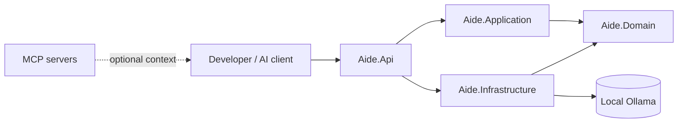
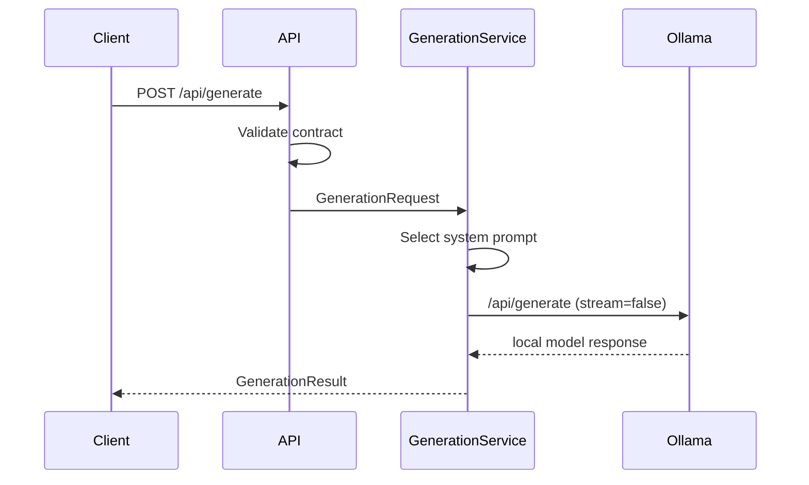

# Architecture

The API is the composition root and HTTP boundary. Application owns use-case orchestration. Domain owns stable contracts and has no framework dependency. Infrastructure owns Ollama HTTP and prompt selection. This Clean Architecture core uses vertical slices at the endpoint/workflow level without adding mediator ceremony.

## Generation sequence

Ollama unavailability maps to a sanitized 503. The framework does not silently substitute cloud inference. Generated text is untrusted: a human must review it before code, configuration, or operational use.

## Extending

Add a `WorkflowKind`, prompt, and tests for a new workflow. Implement `ILocalLanguageModel` to support another local engine. Keep vendor JSON and transport concerns inside Infrastructure.
